<picture>
  <source media="(prefers-color-scheme: dark)" srcset="./dark.svg">
  <source media="(prefers-color-scheme: light)" srcset="./light.svg">
  
</picture>

### Full-Stack Developer · MERN · AI/ML

Building practical software at the intersection of web development, machine learning, and engineering.

[GitHub](https://github.com/Ashishkumar18114) · [LinkedIn](https://www.linkedin.com/in/ashish-kumar-2bb739285/) · [LeetCode](https://leetcode.com/u/ashishkmr11293/) · [Email](mailto:ashishkmr11293@gmail.com)

## About me

- 🎓 B.E. in **Electronics & Communication Engineering** at **JSS Academy of Technical Education, Bengaluru** (2023–2027).
- 💼 **Backend Intern** at **SYNTECXHUB** and **Software Developer Intern** at **Yuga Yatra Retail**.
- 🤝 **GSSoC 2026 Open Source Mentor**, focused on web development (MERN).
- 🔭 Working on AI-integrated web applications; exploring Next.js, machine learning, and scalable backend systems.
- 🧩 Interested in problem-solving, DSA, OOP, databases, and open-source collaboration.

## Featured projects

| Project | What it does | Technologies |
| :-- | :-- | :-- |
| **Fraud Shield** | Detects potential digital-arrest scams from chats, transcripts, and voice-analysis signals. | Flask · Gemini API · Next.js · Clerk |
| **[DrowseGuard](https://github.com/KUNDANIOS/drowsiness)** | Real-time driver-drowsiness monitoring using facial and head-motion signals with an ESP32-CAM stack. | Python · MediaPipe · Flask · ESP32 |
| **Movie Ticket Booking** | Movie-booking workflow with seat selection, authentication, roles, payments, and confirmation email. | React · Node.js · Express · MongoDB |
| **Emotion Detection App** | Facial-emotion recognition using a transformer model exposed through an API. | Python · Flask · Transformers |

<b>More code and projects</b>

- [Drowsiness Detection System](https://github.com/Ashishkumar18114/Drowsiness-Detection-System)
- [ATM Simulation System](https://github.com/Ashishkumar18114/atm-simulation-system)
- [Shopping Cart System](https://github.com/Ashishkumar18114/shopping-cart-system)
- [Payroll Management System](https://github.com/Ashishkumar18114/payroll-management-system)
- [All repositories](https://github.com/Ashishkumar18114?tab=repositories)

## Engineering stack

| Area | Tools and technologies |
| :-- | :-- |
| **Frontend** | HTML · CSS · JavaScript · React · Next.js · Bootstrap |
| **Backend** | Node.js · Express · Python · Flask · Java |
| **Data** | MongoDB · Firebase |
| **AI / ML** | TensorFlow · OpenCV · Python |
| **Cloud & tools** | Google Cloud · Git · GitHub · Postman · VS Code |

## Experience and recognition

- **GSSoC 2026** — Open Source Mentor (Web Development / MERN)
- **Oracle Certified Foundations Associate** (2025)
- **J.P. Morgan Chase & Co.** — Software Engineering Job Simulation, Forage
- **Google Cloud** — Image Classification with TensorFlow skill badge
- **Teliport S4 / Tata Elxsi** — team entry, Predictive Maintenance case study

## Contribution activity

<!-- The two snake SVGs appear after the github-snake repository's workflow runs successfully. -->
<picture>
  <source media="(prefers-color-scheme: dark)" srcset="https://raw.githubusercontent.com/Ashishkumar18114/github-snake/output/github-snake-dark.svg">
  <source media="(prefers-color-scheme: light)" srcset="https://raw.githubusercontent.com/Ashishkumar18114/github-snake/output/github-snake.svg">
  
</picture>

The contribution animation is generated by a scheduled GitHub Action once the companion <code>github-snake</code> repository is set up.

## Let's connect

I'm open to discussing software development, AI/ML, open-source projects, and collaboration.

- [LinkedIn](https://www.linkedin.com/in/ashish-kumar-2bb739285/)
- [LeetCode](https://leetcode.com/u/ashishkmr11293/)
- [Email](mailto:ashishkmr11293@gmail.com)

---

Build · Learn · Repeat

